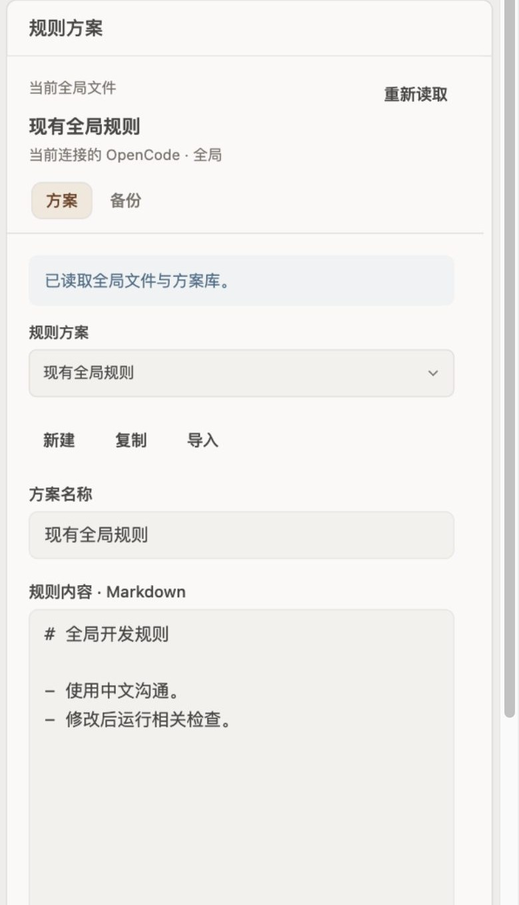

# openchamber-agents

English | [简体中文](#简体中文)

## English

**AGENTS.md Manager** keeps multiple global `AGENTS.md` rule profiles and switches between them safely. Each activation shows a line-by-line diff, backs up the current file, writes atomically and reads it back. A compact Work Status section shows the active profile.

### Highlights

- Library of rule profiles with create, duplicate, import, archive, export and one-click rule copy.
- Live line/character counts, estimated context-token budget indicator, and Markdown heading quick jump.
- Unmatched live `AGENTS.md` banner to adopt external changes as a new profile or inspect a read-only diff before activation; automatic backup and restore.
- Detects external edits, corrupted libraries and permission errors instead of silently overwriting.
- No background service, model calls, session sending or network requests.
- Only touches `~/.config/opencode/AGENTS.md` and `~/.config/openchamber/agents-manager/**`.
- Uses SDK 2.7.0; on OpenChamber 2.7.0 non-Latin-1 project paths work through the fixed directory-header encoding.

- Panel and Work Status copy follow the host language (Simplified Chinese or English).
### Screenshot



*Synthetic preview with sample rules. No real global rules are read or changed.*

### Install

In OpenChamber, open **Settings → Extensions → Add extension** and paste:

```text
https://github.com/chenyuhao0628/openchamber-agents
```

Requires OpenChamber **2.4.0 or newer**; **2.7.0** is recommended for projects with non-Latin-1 folder names. This extension manages rule text, not OpenCode's agent selector.

> The panel and Work Status copy follow the host language (Simplified Chinese or English). The full Chinese documentation is below.

---

## 简体中文

当前版本 **0.2.0**，核对日期 **2026-11-11**。面板文案跟随宿主语言在简体中文和英文间切换。在 OpenChamber 中管理多个全局 `AGENTS.md` 方案：编辑、Token 预算估算、Markdown 大纲快速跳转、未匹配实际全局规则时的纳管与只读对比、差异预览、启用、备份恢复。支持右侧独立面板和工作状态摘要，跟随宿主主题。

> 本仓库只发布扩展框架，不包含任何实际全局规则内容。首次打开会读取本机现有的 `~/.config/opencode/AGENTS.md` 作为方案来源。

这里管理的是**规则文本方案**，不是 OpenCode 的主智能体、子智能体或模型选择器。宿主原有的「设置 → 行为 → 全局 AGENTS.md」编辑同一个文件；本扩展在此基础上增加方案库和切换流程。

## 安装与路径

### 从 GitHub 安装（可自动更新）

在 OpenChamber **设置 → 扩展 → 添加扩展** 中粘贴：

```text
https://github.com/chenyuhao0628/openchamber-agents
```

设置页会按仓库根 `package.json` 的 `version` 检查更新。有新版本时，卡片会显示「更新」。只有 Git URL 安装会自动更新；文件夹和 zip 安装需要手动替换。

### 从文件夹安装（开发）

在本目录运行 `npm ci`、`npm run typecheck`、`npm test`，然后通过 OpenChamber **设置 → 扩展 → 添加扩展 → 文件夹** 添加本目录。安装时宿主会显示两个文件范围：

| 范围 | 用途 |
| --- | --- |
| `~/.config/opencode/AGENTS.md` | 读取并按用户操作替换全局规则 |
| `~/.config/openchamber/agents-manager/**` | 方案库、备份与导出 |

文件由**当前连接的 OpenChamber 服务器**读写；连接远程实例时，不应把路径理解为桌面电脑本地文件。第一版固定上述标准规则路径，不探测自定义 `XDG_CONFIG_HOME`、OpenCode 配置目录或 Codex 的 `~/.codex/AGENTS.md`。实际采用自定义路径时，本版不适用，不能宣称已管理那份规则。

分享给其他用户时，在扩展目录执行 `npm run share`，构建后生成 `dist/openchamber-agents-<版本>.zip`；接收方在 **设置 → 扩展 → 添加扩展** 中选择该 zip 即可安装（无需解压），zip 内附 `安装说明.md` 与完整 README。发行包只包含宿主安装所需的清单、两个 HTML 入口、两个面板脚本与两份说明文档，不含源码、测试与依赖。

清单保守要求 OpenChamber `>=2.4.0`，开发 SDK 为 `2.7.0`。本机此前验证环境为 OpenChamber 2.4.0；2.7.0 已修复非 Latin-1 项目路径的目录请求头，建议在 2.7.0 上使用。SDK 版本与宿主版本是两回事，版本声明不代表所有版本均验证。此扩展没有后台服务、模型调用、会话发送和网络请求权限。若宿主提示文件授权不足，在扩展设置检查声明范围。

## 日常使用

1. 从右侧「规则方案」或工作状态「全局规则 → 管理」进入。两个入口共用同一侧栏编辑器。无项目会话请直接点击右侧「规则方案」图标；原版宿主 2.4.0 的工作状态「管理」入口仍无响应，该限制暂时保留，原因见[已知限制](#已知限制)。首次打开完整面板，将已有全局文本复制为“现有全局规则”；此操作不改写全局文件。仅打开状态摘要不会创建方案库。
2. **新建、复制、导入**产生草稿。名称及 Markdown 可直接编辑。导入使用 `.md` / `.txt` 文件；内容始终按文本处理，不渲染 HTML、不执行规则。
3. **保存方案**只更新方案库，支持 `⌘S` / `Ctrl+S`。切换方案、新建或导入遇到未保存内容时，可以保存后继续、放弃修改或继续编辑。切换页签和主题保留草稿；关闭/重载面板后不保证草稿恢复，请先保存。
4. **预览启用**显示与最新全局文件的逐行差异；确认后备份原文，再次检查文件、原子写入并回读。内容相同时不用写入。空内容会明确提示清空文件。
5. **方案管理**提供归档/恢复、显示归档和导出。归档可恢复，与实际全局文件内容一致的方案不能归档。导出写到连接服务器的数据目录，并显示路径。
6. **备份**中选择时间，查看原文，再「预览恢复 → 确认恢复」。恢复前也会备份当前文件。

顶部显示与实际文件内容匹配的方案，或者“未匹配已保存方案”“全局规则为空”等状态。它不是会话已加载规则的证明。项目内规则仍由 OpenCode 按自己的规则加载机制处理；已有会话的重载行为未验证，启用后建议在新会话确认。

## 数据与故障处理

```text
~/.config/openchamber/agents-manager/
  library.json          # version: 1，保存方案文本与元数据
  backups/<时间-UUID>.json
  exports/<方案ID>.md
```

- 数据保存在声明的文件目录，不使用卸载时会清理的 SDK storage。移除扩展不会由本扩展删除这些文件；备份不自动轮转，整理前自行保留需要的版本。
- 每个方案最多 100,000 字符、名称最多 60 字符；最多 100 个方案，包含归档；方案库序列化上限 1,500,000 字符。初次导入超大现有规则会报错并保持原文件。
- 列表显示宿主列目录结果中最近 50 份备份。备份包含完整原文，受 SDK 单文件 2,000,000 字符上限约束；备份失败会阻止全局写入。原文件不存在时直接创建，SDK 没有删除接口，所以不提供“恢复为文件不存在”。
- 差异按行计算，超大变更使用整块替换表示，最多展示 400 行；超过部分明确标注，可返回编辑器或备份原文检查。CRLF/LF 差异会单独提示，保存不主动改换行。
- 权限、格式或读取失败不能当作空库。方案库损坏时保留原文件并报错。外部编辑会使预览失效，需返回重新预览；方案库冲突时「重新读取」保留草稿，再根据新状态决定保存。
- SDK 写入使用临时文件加原子替换，但没有比较并交换或跨窗口锁。读前复核和写后校验能检测常见冲突，**不能保证多编辑器同时写入时绝对不丢失更新**。操作失败或超时后先重新读取实际状态，不盲目重试覆盖。
- 方案、备份和导出均含完整文本。遵循当前服务器的文件权限；扩展不额外实现加密或 `chmod`。不要把凭据写入规则。

### 打开或重新读取时出现 `Extension operation failed.`

2026-10-19 已用合成扩展、示例路径和通用复现提交上游 [Issue #5179](https://github.com/openchamber/openchamber/issues/5179)。当时在 OpenChamber 2.4.0 上复现：项目路径含中文等超出 Latin-1 范围的字符时，宿主把目录原文放入 `x-opencode-directory` 请求头，浏览器的 `Headers.set` 在发送前抛出异常。错误本身不表示规则文件损坏。

**OpenChamber 2.7.0 已修复这条路径。** 2.7.0 的 `guestFileOperation` 改为把目录作为普通 header 条目交给 `runtimeFetch`；`runtimeFetch` 对非 Latin-1 值做 `encodeURIComponent`，并附加 `x-opencode-directory-encoding: uri` 供服务端解码。源码位置：[2.7.0 files.ts](https://github.com/openchamber/openchamber/blob/v2.7.0/packages/ui/src/lib/guests/files.ts) 与 [runtime-fetch.ts](https://github.com/openchamber/openchamber/blob/v2.7.0/packages/ui/src/lib/runtime-fetch.ts)。0.1.8 已升级到 SDK 2.7.0；在 2.7.0 宿主上，中文项目路径应恢复正常读写。真实宿主仍建议用含中文路径的新会话做一次人工复测，不能只凭源码核对宣告所有远程/旧版环境都通过。

0.1.5 保留的错误诊断仍有意义：它会指出失败的是全局规则、方案库还是备份，并在旧宿主上显示中文原因。重新读取核心文件失败时保留已有内容和草稿，明确标注仍为上次读取结果；写入失败不鼓励盲目重复提交。只记录错误类型与目录字符类别，不输出目录原文或规则内容。

## 已知限制

- 无项目会话中，工作状态「管理」入口可能无响应；请直接点击右侧「规则方案」图标。
- 2.7.0 之前的宿主仍可能在中文等非 Latin-1 项目路径下失败；2.7.0 已修复，建议升级后复测。

## 开发与验证

```sh
npm ci
npm run typecheck
npm test
npm run preview
```

`npm test` 先构建 `panel/main.js` / `panel/section.js`，再运行 Node 测试。`npm run share` 先构建面板脚本，再按宿主 zip 安装限制生成可分发的 `dist/openchamber-agents-<版本>.zip`，并在读回归档复核成员、CRC 与内容后输出校验值。预览脚本只在 `127.0.0.1` 服务本扩展构建产物，所有文件接口通过浏览器内存中的合成数据模拟，**不读取真实全局文件**。终端输出随机端口；可用 `PREVIEW_PORT` 指定端口。支持主题、400/280px 宽度、外部修改、备份失败、权限不足和状态分区切换；URL 的 `state=empty|denied|corrupt` 可检查异常初始状态；`directory=unicode` 或「模拟中文目录」可复现文件请求头错误；`surface=status&directory=none` 复现原版宿主无项目时的导航缺陷；预览只模拟原版行为，不能用它声称实机已修复。

| 目录 | 职责 |
| --- | --- |
| `src/core/` | 方案校验、持久化事务步骤、差异算法 |
| `src/platform/` | SDK 文件接口适配、权限错误说明 |
| `src/panel/view.ts` | 一次挂载的 DOM、SDK 控件、差异展示 |
| `src/panel/main.ts` | 草稿、守卫、保存、预览与启用协调 |
| `src/panel/section.ts` | 只读状态和管理入口 |
| `src/panel/styles/` | 扩展布局及业务样式 |
| `ui/native.css` | 打包时内联的共享宿主基础样式 |
| `tests/` | 内存文件夹具：备份顺序、失败、外部变化、归档、恢复与差异 |

UI 规则见本仓库的 `ui/native.css`；宿主重载与检查记录以本页“开发与验证”为准。官方依据：[SDK API](https://github.com/openchamber/openchamber/blob/main/packages/sdk/API.md)、[OpenCode 规则](https://opencode.ai/docs/rules/)。API 能力以锁定 SDK 的实际类型为准。

0.1.6 将工作状态摘要的状态行压缩到 20px 高，去掉底栏额外上边距，并把清单声明高度从 64px 调整为 56px；与内置提示词扩展保持相同的行高、文字层级和操作位置。

0.1.1 使用宿主支持的 `quill-pen` 羽毛笔图标；工作状态摘要改为两行：左侧标签与读取时间，右侧方案名与操作，去掉重复说明及默认段落间距。无需新权限。当前已安装并启用；初始方案内容与原全局文件一致，接入验证没有改写真实全局规则。

## License

MIT. See [LICENSE](LICENSE).

返回[本仓库首页](README.md)。
